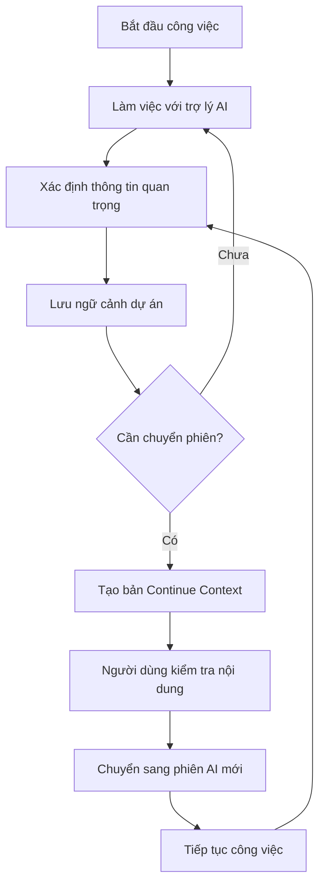
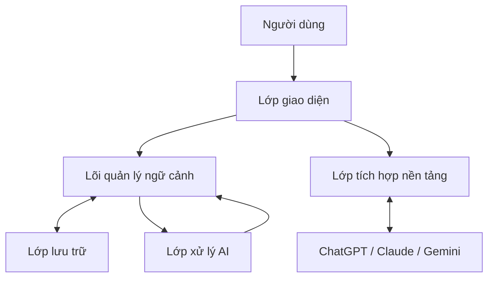

# ◈ C.I.R.C.A

<h1 align="center">C.I.R.C.A</h1>

<p align="center">
  <strong>Context Intelligence & Continuity for AI Workflows</strong>
</p>

<p align="center">
  <em>Giữ ngữ cảnh. Bảo toàn tiến độ. Tiếp tục công việc.</em>
</p>

<p align="center">
  Một không gian làm việc hướng đến việc quản lý ngữ cảnh dự án và duy trì tính liên tục giữa các phiên làm việc với trợ lý AI.
</p>

<p align="center">
  
  
  
  
</p>

---

## 📖 Mục lục

- [1. Giới thiệu](#-1-giới-thiệu)
- [2. Vấn đề cần giải quyết](#-2-vấn-đề-cần-giải-quyết)
- [3. Tầm nhìn và mục tiêu](#-3-tầm-nhìn-và-mục-tiêu)
- [4. Các nguyên tắc thiết kế](#-4-các-nguyên-tắc-thiết-kế)
- [5. Hệ thống tính năng](#-5-hệ-thống-tính-năng)
- [6. Quy trình hoạt động](#-6-quy-trình-hoạt-động)
- [7. Kiến trúc hệ thống](#-7-kiến-trúc-hệ-thống)
- [8. Công nghệ sử dụng](#-8-công-nghệ-sử-dụng)
- [9. Cấu trúc dự án](#-9-cấu-trúc-dự-án)
- [10. Cài đặt và chạy dự án](#-10-cài-đặt-và-chạy-dự-án)
- [11. Hướng dẫn phát triển](#-11-hướng-dẫn-phát-triển)
- [12. Bảo mật và quyền riêng tư](#-12-bảo-mật-và-quyền-riêng-tư)
- [13. Giới hạn hiện tại](#-13-giới-hạn-hiện-tại)
- [14. Lộ trình phát triển](#-14-lộ-trình-phát-triển)
- [15. Đóng góp](#-15-đóng-góp)
- [16. Giấy phép](#-16-giấy-phép)
- [17. Thông điệp dự án](#-17-thông-điệp-dự-án)

---

## ◈ 1. Giới thiệu

**C.I.R.C.A** là một dự án phần mềm hướng đến việc cải thiện cách người dùng quản lý ngữ cảnh, tổ chức thông tin và duy trì tiến độ khi làm việc với các trợ lý AI.

Trong quá trình phát triển phần mềm, một dự án thường trải qua nhiều phiên hội thoại khác nhau. Mỗi phiên có thể chứa những thông tin quan trọng như yêu cầu chức năng, cấu trúc mã nguồn, quyết định kiến trúc, lỗi đang xử lý và những công việc chưa hoàn thành.

Tuy nhiên, khi một phiên hội thoại kết thúc hoặc người dùng chuyển sang nền tảng khác, những thông tin này có thể không được tiếp nối đầy đủ.

C.I.R.C.A được định hướng để trở thành một lớp quản lý ngữ cảnh nằm giữa người dùng, dự án và các trợ lý AI. Thay vì yêu cầu người dùng xây dựng lại toàn bộ bối cảnh mỗi lần bắt đầu phiên mới, hệ thống hướng đến việc lưu giữ, tổ chức và chuyển giao những thông tin cần thiết.

### 🎯 Ý tưởng cốt lõi

> AI có thể thay đổi. Phiên hội thoại có thể kết thúc. Nhưng tiến độ và tri thức của dự án không nên phải bắt đầu lại từ đầu.

C.I.R.C.A không hướng đến việc thay thế ChatGPT, Claude, Gemini hay các mô hình AI hiện có. Trọng tâm của dự án là cải thiện **quy trình sử dụng AI**, đặc biệt trong những công việc dài hạn đòi hỏi khả năng duy trì ngữ cảnh.

### 📌 Thông tin tổng quan

| Thuộc tính                   | Chi tiết                                                             |
| ------------------------------ | --------------------------------------------------------------------- |
| Tên dự án                   | C.I.R.C.A                                                             |
| Lĩnh vực                     | Quản lý ngữ cảnh và quy trình làm việc với AI                |
| Đối tượng hướng đến    | Lập trình viên và người sử dụng AI cho các dự án dài hạn |
| Mục tiêu chính              | Bảo toàn ngữ cảnh và hỗ trợ tiếp tục công việc             |
| Mô hình hoạt động         | Công cụ hỗ trợ quy trình làm việc với AI                      |
| Ngôn ngữ phát triển chính | TypeScript                                                            |
| Công nghệ giao diện         | VS Code API, HTML, CSS và JavaScript                                 |
| Công nghệ thử nghiệm       | Node.js, Electron                                                     |
| Hướng lưu trữ              | Ngữ cảnh cục bộ trên thiết bị người dùng                    |
| Trạng thái                   | Đang phát triển và thử nghiệm                                   |
| Giấy phép                    | Chưa xác định                                                     |

---

## ⚠️ 2. Vấn đề cần giải quyết

### 2.1. Mất ngữ cảnh giữa các phiên hội thoại

Một phiên làm việc dài thường chứa nhiều thông tin mà người dùng không muốn phải giải thích lại.

Ví dụ, khi phát triển một ứng dụng, AI có thể đã biết:

- Cấu trúc thư mục hiện tại.
- Những công nghệ và thư viện đang sử dụng.
- Các quyết định kiến trúc đã được thống nhất.
- Những lỗi đã xuất hiện và cách xử lý trước đó.
- Các chức năng đã hoàn thành.
- Những phần đang phát triển và công việc tiếp theo.

Khi bắt đầu một phiên mới, người dùng có thể phải tự tổng hợp lại tất cả thông tin trên. Việc này tốn thời gian và có thể dẫn đến sai lệch hoặc bỏ sót dữ liệu.

### 2.2. Phân tán thông tin giữa nhiều nền tảng AI

Người dùng có thể sử dụng một nền tảng để phân tích vấn đề, một nền tảng khác để hỗ trợ lập trình và một nền tảng khác để tổng hợp thông tin.

Mỗi nền tảng có cách quản lý hội thoại và ngữ cảnh riêng. Việc chuyển đổi giữa chúng có thể khiến thông tin dự án bị phân tán.

### 2.3. Khó tiếp tục công việc khi phiên hiện tại không còn phù hợp

Một phiên làm việc có thể bị gián đoạn vì nhiều lý do:

- Hội thoại quá dài.
- Giới hạn sử dụng của dịch vụ.
- Cần chuyển sang một mô hình hoặc nền tảng khác.
- Muốn tách một nhiệm vụ thành phiên hội thoại riêng.
- Cần khởi động lại quy trình làm việc với ngữ cảnh rõ ràng hơn.

Trong những trường hợp này, người dùng cần một cách chuyển giao thông tin ngắn gọn nhưng đủ chính xác.

### 2.4. Khoảng trống mà C.I.R.C.A hướng đến

| Vấn đề                                | Hướng giải quyết                                        |
| ---------------------------------------- | ----------------------------------------------------------- |
| Phải giải thích lại dự án          | Lưu trữ ngữ cảnh có cấu trúc                         |
| Thông tin nằm rải rác                | Tổ chức dữ liệu theo dự án                            |
| Chuyển sang phiên AI mới              | Tạo bản bàn giao ngữ cảnh                              |
| Dễ quên quyết định kỹ thuật       | Lưu giữ các quyết định quan trọng                    |
| Ngữ cảnh quá dài và khó sử dụng  | Chọn lọc, phân loại và tóm tắt                       |
| Phụ thuộc vào một phiên hội thoại | Hỗ trợ quy trình tiếp tục thủ công giữa các phiên |

---

## 🧭 3. Tầm nhìn và mục tiêu

### 3.1. Tầm nhìn

C.I.R.C.A hướng đến một môi trường trong đó ngữ cảnh làm việc không bị ràng buộc hoàn toàn vào một cuộc hội thoại hay một nhà cung cấp AI cụ thể.

Người dùng có thể xây dựng ngữ cảnh dự án theo thời gian, sử dụng nó khi cần thiết và chuyển giao những thông tin liên quan sang phiên làm việc tiếp theo.

### 3.2. Sứ mệnh

Tạo ra một công cụ hỗ trợ người dùng:

- Giảm thời gian tái tạo ngữ cảnh.
- Hạn chế thất thoát thông tin giữa các phiên.
- Duy trì tính nhất quán của quyết định kỹ thuật.
- Chủ động quản lý thông tin quan trọng của dự án.
- Sử dụng các trợ lý AI hiện có một cách có hệ thống hơn.

### 3.3. Các mục tiêu chính

| Mã | Mục tiêu                     | Kết quả mong muốn                                                   |
| --- | ------------------------------ | ---------------------------------------------------------------------- |
| G01 | Quản lý ngữ cảnh           | Thông tin được tổ chức theo từng dự án                        |
| G02 | Lưu trữ bền vững           | Ngữ cảnh có thể được sử dụng lại giữa các phiên           |
| G03 | Chuyển giao ngữ cảnh        | Tạo bản tóm tắt phục vụ phiên hội thoại mới                  |
| G04 | Tích hợp nền tảng          | Hỗ trợ quy trình làm việc với nhiều dịch vụ AI                |
| G05 | Kiểm soát của người dùng | Người dùng chủ động quyết định dữ liệu được chuyển giao |
| G06 | Khả năng mở rộng           | Có thể bổ sung nền tảng và phương thức tích hợp mới        |

---

## 💎 4. Các nguyên tắc thiết kế

### 4.1. Context First — Ngữ cảnh là trọng tâm

C.I.R.C.A ưu tiên việc bảo toàn thông tin có giá trị lâu dài đối với dự án, thay vì chỉ lưu giữ các đoạn hội thoại một cách rời rạc.

### 4.2. User in Control — Người dùng giữ quyền kiểm soát

Việc lưu, chọn lọc và chuyển giao ngữ cảnh cần có sự kiểm soát của người dùng. Hệ thống không nên tự ý gửi thông tin dự án đến một nền tảng bên ngoài khi chưa được cho phép.

### 4.3. Platform-Aware, Not Platform-Locked

Dự án hướng đến hỗ trợ nhiều nền tảng AI thông qua các thành phần tích hợp riêng biệt, hạn chế phụ thuộc cứng vào một dịch vụ duy nhất.

### 4.4. Practical Over Hype — Thực tế hơn quảng cáo

C.I.R.C.A tập trung giải quyết một vấn đề cụ thể trong quy trình làm việc. Dự án không tuyên bố có mô hình AI vượt trội, không bảo đảm tăng hạn mức sử dụng và không thay thế chính sách của nhà cung cấp.

### 4.5. Modular by Design — Thiết kế theo mô-đun

Chức năng quản lý ngữ cảnh, xử lý dữ liệu, giao diện và tích hợp nền tảng nên được tách biệt để thuận tiện cho việc kiểm thử, sửa lỗi và mở rộng.

---

## ✨ 5. Hệ thống tính năng

> **Lưu ý:** Bảng dưới đây thể hiện phạm vi tính năng mục tiêu. Trạng thái triển khai thực tế cần được cập nhật theo mã nguồn.

| Tính năng             | Mô tả                                                        | Trạng thái       |
| ----------------------- | -------------------------------------------------------------- | ------------------ |
| Quản lý dự án       | Tổ chức ngữ cảnh theo từng dự án                        | Định hướng     |
| Lưu ngữ cảnh         | Lưu các thông tin quan trọng để sử dụng lại           | Đang phát triển |
| Continue Context        | Tạo bản bàn giao để tiếp tục ở phiên mới             | Định hướng     |
| Phân loại ngữ cảnh  | Nhận diện yêu cầu, quyết định, tiến độ và vấn đề | Định hướng     |
| Tóm tắt bằng AI      | Tạo bản tóm tắt từ dữ liệu được lựa chọn           | Định hướng     |
| Tích hợp ChatGPT      | Hỗ trợ quy trình làm việc với ChatGPT                    | Thử nghiệm       |
| Tích hợp Claude       | Hỗ trợ quy trình làm việc với Claude                     | Thử nghiệm       |
| Tích hợp Gemini       | Hỗ trợ quy trình làm việc với Gemini                     | Định hướng     |
| Lưu trữ cục bộ      | Hướng đến quản lý dữ liệu trên thiết bị             | Định hướng     |
| Giao diện thống nhất | Tập trung các thành phần làm việc trong một không gian | Đang thử nghiệm |

### 5.1. Continue Context

**Continue Context** là một trong những ý tưởng cốt lõi của C.I.R.C.A.

Chức năng này hướng đến việc tạo một bản bàn giao ngữ cảnh có cấu trúc, giúp phiên hội thoại mới tiếp nhận những thông tin quan trọng mà không cần đọc lại toàn bộ lịch sử.

Một bản bàn giao có thể bao gồm:

| Thành phần             | Nội dung                                          |
| ------------------------ | -------------------------------------------------- |
| Tổng quan dự án       | Mục tiêu và chức năng chính                  |
| Công nghệ              | Ngôn ngữ, framework và công cụ sử dụng      |
| Cấu trúc hiện tại    | Những thành phần quan trọng của hệ thống    |
| Quyết định kỹ thuật | Những lựa chọn đã được thống nhất        |
| Tiến độ               | Công việc đã hoàn thành                      |
| Vấn đề tồn tại      | Lỗi, hạn chế và công việc chưa giải quyết |
| Nhiệm vụ tiếp theo    | Những bước cần thực hiện tiếp theo          |
| Lưu ý                  | Ràng buộc và yêu cầu cần duy trì            |

Ví dụ minh họa:

```text
DỰ ÁN: Quản lý công việc bằng AI

MỤC TIÊU
Xây dựng ứng dụng quản lý ngữ cảnh dự án.

CÔNG NGHỆ
TypeScript, Node.js.

QUYẾT ĐỊNH ĐÃ THỐNG NHẤT
- Tách logic xử lý khỏi giao diện.
- Dữ liệu ngữ cảnh được tổ chức theo dự án.

TIẾN ĐỘ
- Đã xây dựng giao diện ban đầu.
- Đang hoàn thiện cơ chế lưu trữ.

VẤN ĐỀ HIỆN TẠI
- Chưa hoàn thiện quy trình khôi phục ngữ cảnh.

NHIỆM VỤ TIẾP THEO
1. Xây dựng cấu trúc dữ liệu.
2. Triển khai lưu và đọc dữ liệu.
3. Kiểm thử quy trình tiếp tục phiên.

YÊU CẦU
Tiếp tục từ trạng thái hiện tại.
Không tự ý thay đổi các quyết định đã thống nhất.
```

Đây là ví dụ về định dạng bàn giao dự kiến, không phải đầu ra được bảo đảm từ phiên bản hiện tại.

### 5.2. Quản lý ngữ cảnh theo dự án

Thay vì coi mọi hội thoại là các đơn vị hoàn toàn độc lập, C.I.R.C.A hướng đến việc tổ chức những thông tin có liên quan thành một ngữ cảnh dự án.

Các loại dữ liệu có thể được quản lý trong tương lai:

- Mục tiêu và yêu cầu.
- Quyết định thiết kế.
- Thông tin kỹ thuật.
- Tình trạng triển khai.
- Các lỗi và giải pháp đã thử.
- Các nhiệm vụ còn tồn đọng.
- Tài liệu tham chiếu.

### 5.3. Tích hợp đa nền tảng

C.I.R.C.A hướng đến việc cung cấp một quy trình nhất quán khi người dùng làm việc với nhiều trợ lý AI.

Mỗi nền tảng có thể yêu cầu một cách tích hợp riêng. Do đó, việc hỗ trợ một nền tảng không đồng nghĩa với việc tất cả nền tảng đã hoạt động hoặc có cùng mức độ tương thích.

### 5.4. Hướng phát triển giao diện

Dự án đã thử nghiệm các hướng triển khai giao diện liên quan đến VS Code và Electron.

| Hướng triển khai | Vai trò dự kiến                                                   |
| ------------------- | -------------------------------------------------------------------- |
| VS Code Extension   | Tích hợp trải nghiệm hỗ trợ AI trong môi trường lập trình |
| Electron Desktop    | Thử nghiệm không gian làm việc desktop                          |
| Thành phần web    | Xây dựng giao diện và vùng hiển thị nội dung                 |

Việc lựa chọn kiến trúc chính thức sẽ phụ thuộc vào khả năng duy trì, độ ổn định và yêu cầu sử dụng thực tế.

---

## 🔄 6. Quy trình hoạt động

### 6.1. Luồng sử dụng tổng quát



*Đây là quy trình hoạt động mục tiêu, không phải khẳng định rằng toàn bộ luồng đã được triển khai.*

### 6.2. Các giai đoạn

| Giai đoạn   | Hoạt động                               | Kết quả                      |
| ------------- | ------------------------------------------ | ------------------------------ |
| 1. Thu thập  | Xác định thông tin cần duy trì       | Dữ liệu ngữ cảnh           |
| 2. Tổ chức  | Phân loại thông tin theo dự án        | Ngữ cảnh có cấu trúc      |
| 3. Lưu trữ  | Lưu dữ liệu để sử dụng lại         | Dữ liệu có thể khôi phục |
| 4. Tổng hợp | Chọn lọc nội dung cần chuyển giao     | Bản tóm tắt                 |
| 5. Kiểm tra  | Người dùng xác nhận tính chính xác | Bản bàn giao hoàn chỉnh    |
| 6. Tiếp tục | Cung cấp ngữ cảnh cho phiên mới       | Công việc được tiếp nối |

---

## 🏛️ 7. Kiến trúc hệ thống

### 7.1. Định hướng kiến trúc

C.I.R.C.A hướng đến việc phân chia hệ thống thành các lớp có trách nhiệm rõ ràng.



Sơ đồ mô tả kiến trúc logic dự kiến. Các lớp và đường kết nối có thể thay đổi khi triển khai thực tế.

### 7.2. Trách nhiệm của từng lớp

| Thành phần               | Trách nhiệm                                                         |
| -------------------------- | --------------------------------------------------------------------- |
| Giao diện người dùng   | Hiển thị nội dung và nhận thao tác                              |
| Lõi quản lý ngữ cảnh  | Điều phối dữ liệu và các thao tác nghiệp vụ                 |
| Lớp lưu trữ             | Lưu, đọc và cập nhật ngữ cảnh                                 |
| Lớp xử lý AI            | Hỗ trợ phân loại và tổng hợp thông tin khi được tích hợp |
| Lớp tích hợp nền tảng | Quản lý các phương thức tương tác với từng dịch vụ       |
| Bộ điều phối           | Kết nối các thành phần theo quy trình đã xác định          |

### 7.3. Nguyên tắc tích hợp nền tảng

Các nền tảng AI có thể khác nhau về giao diện, cơ chế xác thực và chính sách sử dụng.

Vì vậy, C.I.R.C.A hướng đến việc tách logic chung khỏi logic đặc thù của từng nền tảng. Cách tiếp cận này giúp giảm ảnh hưởng khi một nền tảng thay đổi, đồng thời cho phép kiểm thử từng phần độc lập.

Tuy nhiên, tích hợp qua giao diện web có thể dễ bị ảnh hưởng bởi các thay đổi từ nhà cung cấp. Việc lựa chọn API chính thức hay tương tác giao diện cần được đánh giá theo yêu cầu, chi phí và điều khoản của từng dịch vụ.

---

## 🧰 8. Công nghệ sử dụng

| Công nghệ            | Vai trò                              | Ghi chú                                    |
| ---------------------- | ------------------------------------- | ------------------------------------------- |
| TypeScript             | Logic ứng dụng và hệ thống kiểu | Công nghệ phát triển chính             |
| Visual Studio Code API | Tích hợp với VS Code               | Dành cho hướng extension                 |
| HTML                   | Cấu trúc giao diện                 | Thành phần giao diện web                 |
| CSS                    | Trình bày giao diện                | Hỗ trợ tùy chỉnh giao diện             |
| JavaScript             | Logic phía giao diện                | Sử dụng trong các thành phần web       |
| Node.js                | Môi trường chạy JavaScript        | Phục vụ các thành phần ứng dụng      |
| Electron               | Thử nghiệm ứng dụng desktop       | Hướng triển khai đã được khảo sát |
| JSON                   | Cấu hình và trao đổi dữ liệu   | Định dạng dữ liệu phổ biến           |

Danh sách trên phản ánh các công nghệ đã được sử dụng hoặc thử nghiệm trong quá trình phát triển. Không phải mọi công nghệ đều nhất thiết xuất hiện trong bản phát hành cuối cùng.

---

## 📁 9. Cấu trúc dự án

Cấu trúc thư mục chính thức cần được đồng bộ với mã nguồn thực tế. Một cách tổ chức tham khảo cho các thành phần của C.I.R.C.A có thể như sau:

```text
C.I.R.C.A/
├── src/
│   ├── core/
│   │   ├── context/
│   │   ├── session/
│   │   └── workflow/
│   │
│   ├── storage/
│   │   ├── models/
│   │   └── repositories/
│   │
│   ├── providers/
│   │   ├── interfaces/
│   │   └── adapters/
│   │
│   ├── services/
│   │   ├── context-service.ts
│   │   └── summary-service.ts
│   │
│   ├── ui/
│   └── extension.ts
│
├── resources/
├── tests/
├── docs/
├── package.json
├── tsconfig.json
├── .gitignore
└── README.md
```

> **Lưu ý:** Đây là cấu trúc tham khảo để định hướng tổ chức mã nguồn, không phải danh sách tệp đã được xác nhận tồn tại trong repository hiện tại. Không nên tạo tất cả thư mục chỉ để khớp với sơ đồ nếu kiến trúc thực tế chưa cần đến chúng.

### 9.1. Quy tắc tổ chức mã nguồn

- Tách nghiệp vụ quản lý ngữ cảnh khỏi giao diện.
- Hạn chế để logic tích hợp nền tảng phụ thuộc trực tiếp vào thành phần hiển thị.
- Định nghĩa kiểu dữ liệu rõ ràng cho thông tin được lưu trữ và chuyển giao.
- Ưu tiên các thành phần có thể kiểm thử độc lập.
- Tránh lưu thông tin xác thực hoặc khóa API trực tiếp trong mã nguồn.
- Cập nhật tài liệu khi cấu trúc dự án thay đổi đáng kể.

---

## 🚀 10. Cài đặt và chạy dự án

Cách chạy chính xác phụ thuộc vào phiên bản và cấu trúc hiện tại của repository.

### 10.1. Yêu cầu môi trường

| Công cụ          | Mục đích                                             |
| ------------------ | ------------------------------------------------------- |
| Git                | Quản lý mã nguồn                                    |
| Node.js            | Môi trường chạy các công cụ JavaScript           |
| npm                | Quản lý gói phụ thuộc                              |
| Visual Studio Code | Phát triển và thử nghiệm extension                 |
| Electron           | Chỉ cần thiết nếu chạy nhánh desktop tương ứng |

Nên sử dụng phiên bản Node.js được chỉ định trong cấu hình dự án, nếu có.

### 10.2. Lấy mã nguồn

```bash
git clone <URL_REPOSITORY>
cd <TEN_THU_MUC_DU_AN>
```

Thay `<URL_REPOSITORY>` bằng địa chỉ repository thực tế và `<TEN_THU_MUC_DU_AN>` bằng tên thư mục sau khi tải mã nguồn.

### 10.3. Cài đặt phụ thuộc

```bash
npm install
```

Lệnh trên chỉ phù hợp khi repository hiện tại có `package.json` và sử dụng npm.

### 10.4. Kiểm tra các lệnh có sẵn

Mở `package.json` và kiểm tra phần `scripts`.

Ví dụ, nếu dự án đã định nghĩa những script tương ứng:

```json
{
  "scripts": {
    "compile": "tsc -p ./",
    "watch": "tsc -watch -p ./"
  }
}
```

Các script trên chỉ là ví dụ minh họa. Không thay thế phần `scripts` hiện có nếu chưa xác minh cấu hình thực tế.

Nếu dự án có script `compile`, có thể chạy:

```bash
npm run compile
```

Đối với extension VS Code, cách khởi chạy thử nghiệm thường phụ thuộc vào cấu hình debug trong `.vscode/launch.json`. Với nhánh Electron, cần sử dụng script khởi chạy được định nghĩa riêng trong `package.json`.

---

## 👨‍💻 11. Hướng dẫn phát triển

### 11.1. Quy trình phát triển đề xuất

1. Xác định vấn đề cần giải quyết.
2. Kiểm tra cấu trúc và các thành phần liên quan.
3. Thiết kế thay đổi ở phạm vi nhỏ.
4. Triển khai và kiểm tra lỗi kiểu dữ liệu.
5. Kiểm thử hành vi của thành phần vừa sửa.
6. Cập nhật tài liệu nếu cần.
7. Đánh giá ảnh hưởng đến các chức năng hiện có.

### 11.2. Nguyên tắc mã nguồn

| Nguyên tắc             | Yêu cầu                                                      |
| ------------------------ | -------------------------------------------------------------- |
| Dễ đọc                | Đặt tên biến, hàm và kiểu dữ liệu rõ nghĩa          |
| Có trách nhiệm riêng | Một thành phần nên có phạm vi công việc cụ thể       |
| An toàn                 | Không đưa thông tin bí mật vào repository               |
| Có thể kiểm thử      | Hạn chế phụ thuộc khó kiểm soát giữa các thành phần |
| Dễ bảo trì            | Ưu tiên thay đổi nhỏ, rõ ràng                           |
| Có tài liệu           | Ghi lại các quyết định kỹ thuật quan trọng             |

### 11.3. Kiểm tra trước khi hoàn tất thay đổi

- [ ] Mã nguồn biên dịch thành công theo cấu hình dự án.
- [ ] Không làm hỏng chức năng đang hoạt động.
- [ ] Các lỗi được phát hiện đã được xử lý hoặc ghi nhận.
- [ ] Dữ liệu nhạy cảm không xuất hiện trong mã nguồn hoặc log.
- [ ] Tài liệu được cập nhật khi hành vi sử dụng thay đổi.

---

## 🔐 12. Bảo mật và quyền riêng tư

Ngữ cảnh làm việc có thể chứa mã nguồn riêng tư, thông tin kỹ thuật hoặc dữ liệu nội bộ. Vì vậy, quyền kiểm soát dữ liệu là một yếu tố quan trọng trong định hướng của C.I.R.C.A.

### 12.1. Nguyên tắc bảo mật

- **Tối thiểu hóa dữ liệu:** Chỉ lựa chọn thông tin cần thiết cho mục tiêu sử dụng.
- **Kiểm soát chuyển giao:** Người dùng nên xem lại dữ liệu trước khi gửi sang nền tảng bên ngoài.
- **Bảo vệ thông tin xác thực:** Không lưu khóa API, mật khẩu hoặc token trong mã nguồn công khai.
- **Minh bạch về xử lý dữ liệu:** Cần xác định rõ dữ liệu nào được lưu cục bộ và dữ liệu nào được gửi ra ngoài.
- **Tôn trọng quyền riêng tư:** Không mặc định rằng toàn bộ lịch sử hội thoại đều cần được thu thập.

### 12.2. Giới hạn cần lưu ý

Lưu trữ dữ liệu cục bộ không tự động bảo đảm an toàn tuyệt đối. Mức độ bảo vệ còn phụ thuộc vào cách dữ liệu được lưu, quyền truy cập trên thiết bị, cơ chế sao lưu và việc sử dụng các dịch vụ AI bên ngoài.

Các biện pháp bảo mật cụ thể cần được xác minh trong quá trình triển khai thực tế.

---

## ⚠️ 13. Giới hạn hiện tại

C.I.R.C.A đang trong giai đoạn phát triển và thử nghiệm. Những giới hạn dưới đây cần được xem xét khi sử dụng hoặc đánh giá dự án:

| Giới hạn                     | Ảnh hưởng                                                 |
| ------------------------------ | ------------------------------------------------------------ |
| Chức năng đang phát triển | Chưa thể coi toàn bộ quy trình là ổn định           |
| Tích hợp nền tảng          | Có thể bị ảnh hưởng bởi thay đổi từ nhà cung cấp |
| Chất lượng tóm tắt        | Có thể bỏ sót hoặc diễn giải sai thông tin           |
| Khả năng tương thích      | Phụ thuộc vào môi trường và phiên bản sử dụng     |
| Giới hạn dịch vụ AI        | Vẫn tuân theo chính sách của nhà cung cấp             |
| Kiến trúc đang hoàn thiện | Cấu trúc và cách triển khai có thể thay đổi         |

C.I.R.C.A không tự động mở rộng hạn mức của các nền tảng AI, không bảo đảm khả năng truy cập liên tục và không thay thế cơ chế lưu lịch sử chính thức của từng dịch vụ.

---

## 🗺️ 14. Lộ trình phát triển

Lộ trình dưới đây thể hiện thứ tự ưu tiên đề xuất, không phải cam kết về thời gian phát hành.

| Giai đoạn | Hạng mục                                         | Trạng thái       |
| ----------- | -------------------------------------------------- | ------------------ |
| 01          | Xác định kiến trúc chính                     | Đang hoàn thiện |
| 02          | Ổn định giao diện và luồng tương tác      | Đang phát triển |
| 03          | Xây dựng mô hình dữ liệu ngữ cảnh          | Dự kiến          |
| 04          | Triển khai lưu trữ và khôi phục              | Dự kiến          |
| 05          | Xây dựng chức năng Continue Context            | Dự kiến          |
| 06          | Tích hợp các nền tảng AI                      | Đang thử nghiệm |
| 07          | Kiểm thử và cải thiện độ tin cậy           | Dự kiến          |
| 08          | Hoàn thiện tài liệu và hướng dẫn sử dụng | Dự kiến          |

### 🎯 Ưu tiên cốt lõi

Thay vì mở rộng quá nhiều chức năng ngay từ đầu, C.I.R.C.A nên ưu tiên hoàn thiện một quy trình cơ bản nhưng đáng tin cậy:

**Lưu ngữ cảnh → Khôi phục ngữ cảnh → Tạo bản bàn giao → Tiếp tục công việc.**

Khi quy trình này hoạt động ổn định, các tính năng nâng cao và khả năng tích hợp thêm nền tảng có thể được phát triển từng bước.

---

## 🤝 15. Đóng góp

C.I.R.C.A hướng đến một cấu trúc dễ bảo trì và có thể mở rộng. Các đề xuất cải tiến, báo cáo lỗi và ý tưởng tính năng có thể giúp dự án phát triển theo hướng thực tế hơn.

### 15.1. Các hình thức đóng góp

- Báo cáo lỗi và vấn đề tương thích.
- Đề xuất cải tiến quy trình quản lý ngữ cảnh.
- Đề xuất thiết kế giao diện.
- Cải thiện cấu trúc dữ liệu.
- Bổ sung kiểm thử.
- Cải thiện tài liệu và hướng dẫn sử dụng.

### 15.2. Nội dung báo cáo lỗi

Khi báo cáo một lỗi, nên cung cấp:

1. Môi trường và phiên bản đang sử dụng.
2. Các bước tái hiện lỗi.
3. Hành vi mong đợi.
4. Hành vi thực tế.
5. Log hoặc ảnh chụp màn hình có liên quan.

Không đính kèm khóa API, mật khẩu, token hoặc dữ liệu hội thoại riêng tư vào báo cáo công khai.

---

## 📄 16. Giấy phép

Dự án hiện chưa xác định giấy phép phân phối chính thức.

Cho đến khi giấy phép được bổ sung, không nên mặc định rằng mã nguồn được cấp phép theo MIT, Apache-2.0 hoặc một giấy phép mã nguồn mở khác.

Thông tin về quyền sử dụng, sửa đổi và phân phối sẽ được cập nhật khi có quyết định chính thức.

---

## ◈ 17. Thông điệp dự án

<p align="center">
  <strong>AI không nên là nơi duy nhất lưu giữ tiến độ công việc.</strong>
</p>

<p align="center">
  C.I.R.C.A hướng đến việc biến ngữ cảnh từ một phần thông tin dễ thất lạc<br>
  thành tài sản có thể tổ chức, duy trì và sử dụng lại.
</p>

<p align="center">
  <strong>Keep the Context. Continue the Work.</strong>
</p>

---

<p align="center">
  <sub>C.I.R.C.A — Dự án đang trong quá trình phát triển.</sub>
</p>
